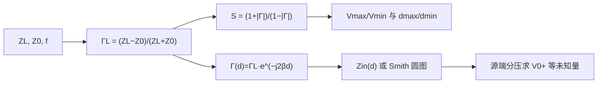

期中临近，把这学期电磁场（PIN 332，英文授课）前半程的考点整理成一篇给学弟学妹的备考指南。范围覆盖 Week 1 电磁学基础、Week 2–3 传输线理论、Smith Chart 专题；所有考点与例题数值都来自课件正文和课堂讲过的原题。

先说两句重要的实话：**这份整理是我对课件的分析归纳，不是老师公布的官方考纲**；考试范围最终以任课老师通知为准。另外课件截图涉及课程材料，这里就不贴了——好在公式和表格本身是自足的，文字版反而更方便检索。

## 期中全景：先搞清楚考什么

### 四大模块与分量

| 模块 | 课件 | 核心内容 | 复习分量 |
|---|---|---|---|
| Week 1 电磁学基础 | Week 1 | 场的概念、库仑定律、E/B 场、行波参数、复数与相量 | ★★ 概念题 + 小计算，分值不大但不能丢 |
| Week 2 传输线理论 | Week 2 | R'L'G'C'、电报方程、反射/驻波/VSWR、输入阻抗、匹配、暂态 | ★★★★★ 绝对核心 |
| Week 3 传输线理论 2 | Week 3 | Week 2 全部内容的重讲与加深，暂态/脉冲/TDR 完整例题 | ★★★★★ 与 Week 2 合并复习 |
| Smith Chart | Smith Chart Extra | 圆图操作、VSWR 读图、L 型匹配、单支节匹配 | ★★★★ 大题工具，必须练熟 |

**一个重要认知**：Week 2 和 Week 3 内容高度重叠（Week 3 相当于把传输线理论再讲一遍并补齐暂态部分），连例题都是同几道（比如 λ/4 变换器的 70.7 Ω、驻波 S=1.86）。这说明**老师极度重视传输线理论**——复习请以传输线为中心，Week 1 保住概念题和基本计算即可。

### 最可能考的题型（按优先级）

稳态综合题几乎都是同一条流水线：

| # | 题型 | 核心公式/方法 |
|---|---|---|
| 1 | 给 $Z_L,Z_0$ 求 $\Gamma_L$、VSWR、$V_{\max}/V_{\min}$ 及第一极值位置 | $2\beta d-\theta_r=2n\pi$（最大）/ $(2n+1)\pi$（最小） |
| 2 | 矩形脉冲的负载电压波形（6 V / −1.8 V / 0.54 V 那道） | 双阶跃分解 + $(1+\Gamma_L)V_1^+$ + $q=\Gamma_g\Gamma_L$ |
| 3 | TDR 故障定位三问 | $d=u_p\Delta t/2$、$\Gamma_f=\Delta V/V_1^+$、$R_f$ 并联拆解 |
| 4 | Smith 圆图求输入阻抗/极值位置 | 归一化 → 等 $\lvert\Gamma\rvert$ 圆 → WTG 顺时针 → 乘回 $Z_0$ |
| 5 | R'L'G'C' 参数计算 | 查表公式，**注意半径 vs 直径** |
| 6 | 输入阻抗、短/开路线等效元件、λ/4 变换器 | $Z_{02}=\sqrt{Z_{01}R_L}$ |
| 7 | L 型匹配 / 双电容匹配 | 串元件沿等 r 圆、并元件沿等 g 圆 |
| 8 | 阶跃激励反弹图、固定点波形 | $V_1^+=Z_0V_g/(R_g+Z_0)$ 逐次累加 |
| 9 | 行波表达式读参数 | $y=A\cos(\omega t-\beta x+\phi_0)$ 各符号 |
| 10 | 相量法解 R-C 正弦稳态 | $Z=R-\frac{j}{\omega C}$ |
| 11 | 概念判断/简答 | 真空波速、光子、右手定则、四场量单位 |

## Week 1｜电磁学基础：送分题都在这

### 四个场量与介质关系

$\mathbf E$ 电场强度（V/m）、$\mathbf D$ 电通量密度（C/m²）、$\mathbf B$ 磁通量密度（T）、$\mathbf H$ 磁场强度（A/m）；线性各向同性介质满足 $\mathbf D=\epsilon\mathbf E$、$\mathbf B=\mu\mathbf H$。静止电荷对应静电（Electrostatics），恒定电流对应静磁（Magnetostatics），时变电流才是电场磁场相互耦合（Dynamics）。

$$\mathbf E=\frac{q}{4\pi\epsilon_0 R^2}\hat{\mathbf R},\qquad \mathbf F=q_t\mathbf E,\qquad \mathbf B_{\text{长直导线}}=\frac{\mu_0 I}{2\pi r}\hat{\boldsymbol\phi}$$

两个概念坑：负试验电荷受力方向与 $\mathbf E$ **相反**；$\mathbf E$ 只由源电荷决定、与试探电荷无关。长直导线磁场是 $1/r$ 衰减（不是 $1/r^2$），方向用右手握持定则。

### 正弦行波（Week 1 计算题最大来源）

$$y(x,t)=A\cos(\omega t-\beta x+\phi_0),\qquad f=\frac1T,\quad \omega=2\pi f,\quad \beta=\frac{2\pi}{\lambda},\quad u_p=\frac{\omega}{\beta}=f\lambda$$

读图要点考试直接考：固定 t 的图读波长 λ，固定 x 的图读周期 T；$\omega t-\beta x=\text{const}$ 沿 $+x$ 传播，$\omega t+\beta x$ 沿 $-x$；$T/4$ 后波形前移 $\lambda/4$；$\phi_0=+\pi/4$ 表示超前参考波 $T/8$。衰减波 $y=Ae^{-\alpha x}\cos(\omega t-\beta x)$ 的包络 $Ae^{-\alpha x}$ 是**幅度**不是瞬时值，半衰距离 $d_{1/2}=\ln 2/\alpha$。

### 电磁波与频谱

真空中所有电磁波同速（$c\approx3.0\times10^8$ m/s，无线电波和 X 射线一样快——课件原题答案是 True，注意限定 in vacuum）；平面波中 $\mathbf E\perp\mathbf B$ 且都垂直于传播方向，方向用 $\mathbf E\times\mathbf B$ 判断（次序不能反）。要会按频率排序频段：HF(3–30 MHz) → VHF(30–300 MHz) → UHF(300 MHz–3 GHz) → SHF(3–30 GHz) → EHF(30–300 GHz)；常用换算：100 MHz→3 m（VHF）、2.4 GHz→12.5 cm（UHF）、60 GHz→5 mm（EHF）。

### 复数与相量（Week 1 压轴）

$$z=a+jb=|z|e^{j\theta},\qquad A\cos(\omega t+\phi)\leftrightarrow A\angle\phi,\qquad \frac{d}{dt}\leftrightarrow j\omega$$

串联 R-C 正弦稳态的课堂主线：$Z_{RC}=R-\frac{j}{\omega C}$，$\tilde I=\tilde V_s/Z_{RC}$，电流超前电压的相角 $\delta=\tan^{-1}\frac{1}{\omega RC}$。

**Week 1 易错点 Top 5**：词头不换算就代入（μC、nC、cm 必须先换 SI，$(20\ \mathrm{cm})^2=0.04\ \mathrm{m^2}$）；把 ω 当 f、把 β 当 $1/\lambda$（都差一个 $2\pi$）；相角不修象限（$-3+j4$ 的辐角是 $126.87^\circ$ 不是 $-53.13^\circ$，用 atan2）；正弦源不转余弦直接写相量（$10\sin(1000t+30^\circ)$ 的相量是 $10\angle(-60^\circ)$）；峰值与 RMS 混用（$V_{\mathrm{rms}}=V_0/\sqrt2$）。

> ⚠️ 课件 p.32 的式 (26)(28) 有疑似排版错误，p.30 电路图未给参数。复习以「建模 → 转相量 → 复数除法 → 恢复时域」这个流程为准，别照抄那一页的结果。

## 传输线理论（Week 2+3）：期中的绝对核心

### 电长度：什么时候必须用传输线理论

判断标准是电长度 $l/\lambda$，不是几何长度。课件原例：1 kHz 时 λ=300 km，60 km 线的 $l/\lambda=0.2$（相移 72°，必须按传输线算），0.6 m 线可忽略；**同一根 0.6 m 线在 100 MHz（λ=3 m）下就必须按传输线处理**。经验警戒线 $l/\lambda\gtrsim0.01$。

### 单位长度参数 R'L'G'C'

$R^\prime$（Ω/m）导体损耗、$L^\prime$（H/m）磁场储能、$G^\prime$（S/m）介质漏电、$C^\prime$（F/m）电场储能；理想导体 → $R^\prime=0$，理想介质 → $G^\prime=0$（两个独立条件）。**算完必查一致性**：均匀介质 TEM 线满足 $L^\primeC^\prime=\mu\epsilon$、$G^\prime/C^\prime=\sigma/\epsilon$。

课件原题（参数题模板）：

| 题 | 结构 | 答案 |
|---|---|---|
| 2-1 | 双导线空气线（理想导体），半径 1 mm，中心距 2 cm | $R^\prime=0$，$L^\prime\approx1.20\ \mu$H/m，$G^\prime=0$，$C^\prime\approx9.29$ pF/m |
| 2-2 | 铜同轴空气线，1 MHz，内外导体直径 0.6/1.2 cm | $R^\prime\approx2.07\times10^{-2}\ \Omega$/m，$L^\prime\approx0.139\ \mu$H/m，$G^\prime=0$，$C^\prime\approx80.3$ pF/m |

> ⚠️ 动笔第一步先分清**半径还是直径**：双导线题给半径 1 mm、直径是 2 mm，$D/d=10$（不是 20）；同轴题给直径先除以 2。

### 电报方程与传播参数

$$\gamma=\sqrt{(R^\prime+j\omega L^\prime)(G^\prime+j\omega C^\prime)}=\alpha+j\beta,\qquad Z_0=\sqrt{\frac{R^\prime+j\omega L^\prime}{G^\prime+j\omega C^\prime}}$$

无耗线（$R^\prime=G^\prime=0$）退化出全套常用结论：$\beta=\omega\sqrt{L^\primeC^\prime}$，$Z_0=\sqrt{L^\prime/C^\prime}$，$u_p=1/\sqrt{L^\primeC^\prime}=c/\sqrt{\epsilon_r}$。注意 $Z_0$ 是**单个行波**的电压电流比，不等于任意点的总电压/总电流；反向电流波带负号：$I_0^-=-V_0^-/Z_0$。

### 反射、驻波与 VSWR

$$\Gamma_L=\frac{Z_L-Z_0}{Z_L+Z_0}=\rho e^{j\theta_r},\qquad S=\frac{1+\rho}{1-\rho},\qquad V_{\max}=|V_0^+|(1+\rho),\qquad V_{\min}=|V_0^+|(1-\rho)$$

极值位置条件：电压最大 $2\beta d_{\max}-\theta_r=2n\pi$，最小 $2\beta d_{\min}-\theta_r=(2n+1)\pi$。

**课件原例**（$Z_0=50\ \Omega$，$|V_0^+|=1$ V，$\Gamma_L=0.3e^{j30^\circ}$）：$V_{\max}=1.3$ V、$V_{\min}=0.7$ V、$S=1.86$；补充 $d_{\max}=\lambda/24$、$d_{\min}=7\lambda/24$、$I_{\max}=26$ mA、$I_{\min}=14$ mA。

必须形成条件反射的几条：匹配 $\Gamma_L=0$｜开路 $\Gamma_L=+1$｜短路 $\Gamma_L=-1$｜纯电抗负载 $\lvert\Gamma_L\rvert=1$；相邻同类极值间隔 $\lambda/2$，最大与最小间隔 $\lambda/4$；**电压最大处电流最小**；$V_{\max}$ 处 $Z=Z_0S$、$V_{\min}$ 处 $Z=Z_0/S$；只给 S 只能得到 $\rho$，**定不出复负载**（相角丢了）。

### 沿线阻抗与特殊线长

$$Z_{\mathrm{in}}=Z_0\frac{Z_L+jZ_0\tan\beta l}{Z_0+jZ_L\tan\beta l}$$

| 线长 | 结果 | 备注 |
|---|---|---|
| $l=n\lambda/2$ | $Z_{\mathrm{in}}=Z_L$ | 阻抗不变 |
| $l=(2n+1)\lambda/4$ | $Z_{\mathrm{in}}=Z_0^2/Z_L$ | 倒置：开路↔短路互换 |
| 短路线 | $Z_{\mathrm{in}}=jZ_0\tan\beta l$ | $l<\lambda/4$ 呈感性 |
| 开路线 | $Z_{\mathrm{in}}=-jZ_0\cot\beta l$ | $l<\lambda/4$ 呈容性 |
| 开短路测量 | $Z_0=\sqrt{Z_{\mathrm{in}}^{sc}Z_{\mathrm{in}}^{oc}}$ | 反求参数 |

课件原例：50 Ω 馈线匹配 100 Ω 负载 → 变换段 $Z_{02}=\sqrt{50\times100}=70.7\ \Omega$，长度为**变换段内**波长的 λ/4。只对设计频率和实数负载成立。

### 集总参数匹配网络

解题思想只有两条：**实部匹配到位 + 虚部彻底抵消**。对课件的原题（感性支路放电容到地，符号解）：

$$\operatorname{Re}Y_A=\frac{1}{R_T}\ \Rightarrow\ X=\sqrt{R_s(R_T-R_s)},\qquad C_1=\frac{1}{\omega(\omega L_s-X)},\qquad C_2=\frac{X}{\omega R_s R_T}$$

可实现条件 $R_T>R_s>0$ 且 $\omega L_s>X$。配套笔记里有一组数值练习：$R_T=50\ \Omega$、$R_s=10\ \Omega$、$L_s=1\ \mu$H、$f=13.56$ MHz → $C_1\approx180.0$ pF、$C_2\approx469.5$ pF。

### 暂态：反弹图、脉冲与 TDR（Week 3 招牌大题）

四个基本量：

$$V_1^+=\frac{Z_0 V_g}{R_g+Z_0},\qquad \Gamma_L=\frac{R_L-Z_0}{R_L+Z_0},\qquad \Gamma_g=\frac{R_g-Z_0}{R_g+Z_0},\qquad T=\frac{l}{u_p}$$

反弹图读图规则：每次波到达端点乘该端反射系数；观察点电压是**已到达各波的代数和**；负载端每次跳变是 $(1+\Gamma_L)A$（不是 $\Gamma_L A$）；反向波电流带负号；直流终值校验 $V_\infty=V_g R_L/(R_g+R_L)$。

**原题 ①：脉冲传播**。5 V 矩形脉冲（τ=1 ns），$R_g=12.5\ \Omega$、$Z_0=50\ \Omega$、$R_L=150\ \Omega$、$l=0.6$ m：$T=2$ ns → $V_1^+=4$ V → $\Gamma_L=0.5$、$\Gamma_g=-0.6$。负载波形依次是 **6 V（2–3 ns）→ −1.8 V（6–7 ns）→ 0.54 V（10–11 ns）**，通式 $6\sum(-0.3)^n\{u[t-(2+4n)]-u[t-(3+4n)]\}$ V。为什么负载能出现比源还高的 6 V？因为负载电压增量是 $(1+\Gamma_L)V_1^+=1.5\times4=6$ V。

**原题 ②：TDR 故障定位**。75 Ω 匹配线（Teflon $\epsilon_r=2.1$），源端电压 0 → 6 V，12 μs 后降到 3 V：(a) $R_g=Z_0$ 时源端分压一半 → $V_g=12$ V；(b) $u_p=c/\sqrt{2.1}\approx2.07\times10^8$ m/s，$d=u_p\Delta t/2\approx1242$ m（**往返必须除 2**）；(c) 跳变量 −3 V → $\Gamma_f=-0.5$ → 故障处等效 25 Ω → 由并联关系得 **$R_f=37.5\ \Omega$**。

### 传输线易错点（每条对应一个丢分点）

1. **半径/直径**：动笔第一步先统一成半径。
2. **往返除 2**：TDR 距离 $d=u_p\Delta t/2$，漏除会得 2484 m。
3. **负载跳变**是 $(1+\Gamma_L)V_{\mathrm{inc}}$，不是 $\Gamma_LV_{\mathrm{inc}}$。
4. **TDR 反射系数用跳变量**：6→3 V 是 $\Gamma_f=-0.5$ 不是 +0.5；25 Ω 是等效阻抗，真正并联故障电阻是 37.5 Ω。
5. **tan 的分支与角度制**：$\beta l$ 用 rad；反求线长解不唯一，取最小非负解。
6. **两套坐标别混用**：稳态部分负载在 $z=0$、朝源距离记 $d$；暂态部分源在 $z=0$、负载在 $z=l$。
7. **三个阻抗分清**：$\eta=\sqrt{\mu/\epsilon}$ 是介质场阻抗；$Z_0$ 是特性阻抗；$Z(d)$ 是该点总电压/总电流。
8. **撇号是「每米」**：$L^\prime$ 是单位长度电感，不是导数。

## Smith Chart：会画图，大题稳拿

### 圆图上有什么

底层坐标是 $\Gamma=\Gamma_r+j\Gamma_i$：圆心是匹配（$\Gamma=0$），最左端短路（$\Gamma=-1$），最右端开路（$\Gamma=+1$）；上半平面感性、下半平面容性；水平轴纯电阻，右交点 $z_{\max}=S$、左交点 $z_{\min}=1/S$。

课堂原题速查（七种负载的 Γ）：$z_L=2\to\Gamma=1/3$；$z_L=1-j1\to0.447\angle-63.4^\circ$；$z_L=0.5-j2\to0.825\angle-50.9^\circ$；$z_L=-j3\to1\angle-36.9^\circ$；短路 $\to-1$；开路 $\to+1$；匹配 $\to0$。

### 必背公式

$$z=\frac{Z}{Z_0}\ (\text{无单位}),\qquad \Gamma=\frac{z-1}{z+1},\qquad z=\frac{1+\Gamma}{1-\Gamma},\qquad \Delta\theta=2\beta d=720^\circ\cdot\frac{d}{\lambda}$$

导纳侧：$y=1/z=Y/Y_0$；$X_L=\omega L$、$B_C=\omega C$、$X_C=-1/\omega C$、$B_L=-1/\omega L$。

### 标准操作流程（照做就能得分）

1. **归一化** $z_L=Z_L/Z_0$，标点（等 r 圆 × 等 x 弧交点）；
2. **画等 $\lvert\Gamma\rvert$ 圆**（等 S 圆）；
3. **旋转**：向源（WTG）**顺时针**，向负载逆时针；转角 $720^\circ\cdot d/\lambda$，**一整圈对应 λ/2**（不是 λ）；
4. **读数并反归一化**：读出 $z_{\mathrm{in}}$ 乘回 $Z_0$。

课件原例（$z_L=2-j1$ 向源 0.1λ）：WTG 刻度 0.287 → 0.387 → $z(d)=0.6-j0.66$。**WTG 外圈刻度差是电长度（距离），不是电阻——别把 0.387 当输入电阻！**

配套口诀：上图先除 $Z_0$，下答乘回 $Z_0$；沿线等 $\lvert\Gamma\rvert$ 圆，串联等 r 圆，并联等 g 圆；朝源顺时针，一圈半波长；匹配 = r=1 且 x=0；d 管实部到位，ℓ 管虚部清零，双解成对写，回代核验。

### L 型匹配网络（带完整数值的课堂原题）

$Z_L=10+j5\ \Omega$ 匹配到 $Z_S=50\ \Omega$，$f=50$ MHz，要求网络兼作高通滤波器（HPF → 串 C 并 L）：

1. 归一化 $z_L=0.2+j0.1$，目标 $z_{\mathrm{in}}=1$；
2. 串 $C_1$：沿等 r=0.2 圆向下到与 g=1 圆交点 $z_A=0.2-j0.4$ → $X_C=25\ \Omega$ → $C_1\approx127.32$ pF；
3. 并 $L$：此时 $y_A=1+j2$，需抵消 $b=2$ → $L\approx79.58$ nH；
4. **回代验证** $Z_{\mathrm{in}}=50+j0\ \Omega$——不能只看图上「接近圆心」。

### 单支节匹配（流程要会）

两类距离别混：**支节位置 d**（主线上）与**支节长度 ℓ**（支节上）。并联支节：主线沿等 $\lvert\Gamma\rvert$ 圆找 g=1 的两个交点得两组 d；支节提供 $y_s=-jb_d$ 清虚部得对应 ℓ。**两组解必须同组配对**不能交叉混搭；问 first 时取最小非负距离；负的 arctan 结果加 λ/2 取物理正长度。

### Smith Chart 易错点

归一化量 $z,y$ **不带单位**（课件原图就误标了 Ω，别学它）；朝源顺时针、转角是 $2\beta d$ 不是 $\beta d$；一圈 = λ/2；相角必须用 atan2 判象限（$-0.5-j0.2$ 是 $202^\circ$ 不是 $21.8^\circ$）；串联电容加**负**电抗、并联电感加**负**电纳；导纳反归一化是 $Y=y/Z_0$（不是乘）；读图结果是近似值，卷面写「≈」并回代核验。

## 考前冲刺清单

### 「必须会」清单（达不到就别上考场）

- 给复数 $Z_L$：3 分钟内算出 $\Gamma_L$、$S$、$V_{\max/\min}$、最近 $d_{\max}/d_{\min}$；
- 独立复现两道暂态原题：脉冲 6/−1.8/0.54 V 与 TDR 12 V/1242 m/37.5 Ω；
- 不看公式表写出 $Z_{\mathrm{in}}$ 一般式、短/开路线输入阻抗、λ/4 与 λ/2 结论；
- 给 $z_L$ 和 $d/\lambda$：圆图完成「标点 → 等 S 圆 → 顺时针 → 读数乘 $Z_0$」全套；
- 复现 L 网络例题（127.32 pF + 79.58 nH）并回代验证；
- R'L'G'C' 参数题分清半径直径，算完用 $L^\primeC^\prime=\mu\epsilon$ 自查；
- 行波表达式读全参数 + 相量法 R-C 电路一条龙。

### 三天复习路线

| 天 | 内容 | 方法 |
|---|---|---|
| 第 1 天 | 传输线稳态 | 推一遍电报方程；重做参数题、驻波例题、λ/4 例题 |
| 第 2 天 | 暂态 + TDR + 圆图 | 白纸画反弹图；两道原题闭卷重做；圆图铅笔直尺练 3 道 |
| 第 3 天 | Week 1 + 匹配 + 公式默写 | 概念题过一遍；匹配题重做；合上资料默写全部公式 |

### 考前最后扫一眼

相量约定 $e^{j\omega t}$、余弦参考、峰值相量；稳态负载记 $z=0$、暂态源记 $z=0$；撇号 = 每单位长度；归一化 $z,y$ 无单位；电流反射系数 $=-\Gamma_L$；$u_p$ 永远用线内介质的 $c/\sqrt{\epsilon_r}$；常数：$\epsilon_0=8.854\times10^{-12}$ F/m、$\mu_0=4\pi\times10^{-7}$ H/m、$e=1.602\times10^{-19}$ C。

视频资源（都看过、可推荐）：B 站鼎阳科技《一个视频带你看懂史密斯圆图》（8 min，建立图形直觉）、《史密斯圆图知识点整理及例题讲解》（17 min）、《L 网络阻抗匹配电路的设计》（11 min，对应上面原题）、《Smith 圆图应用之单支节匹配》（6 min）；网页工具 QuickSmith 可以在纸面作图后核验轨迹。

## 写在最后

这份指南覆盖的是「课件里真实讲过、真实算过」的内容。传输线这部分初学时觉得抽象，但把反弹图画熟、圆图转顺之后会发现它其实是整门课最「讲道理」的部分——每一步都有明确的几何与代数对应。把每一道课件原题独立复现出来，期中就不会有意外。

祝考试顺利。

## 参考来源

- 课件：Week 1、Week 2 Transmission Line Theory、Week 3 Transmission Line Theory 2、Smith Chart Extra（本文考点与例题数值均出自课件正文与课堂讲解；课件截图涉及课程材料，此处未收录，需要图示的同学可以对照原课件）
- 考点归纳参考了本人的备考笔记与课堂例题整理；文中标注「课件原题/原例」的数值照抄课件，标注「练习」的为自编题，**不是教师公布的题目**；考试范围最终以任课教师通知为准
- B 站视频：鼎阳科技《一个视频带你看懂史密斯圆图》等四期（见正文）；QuickSmith（quicksmith.online）
